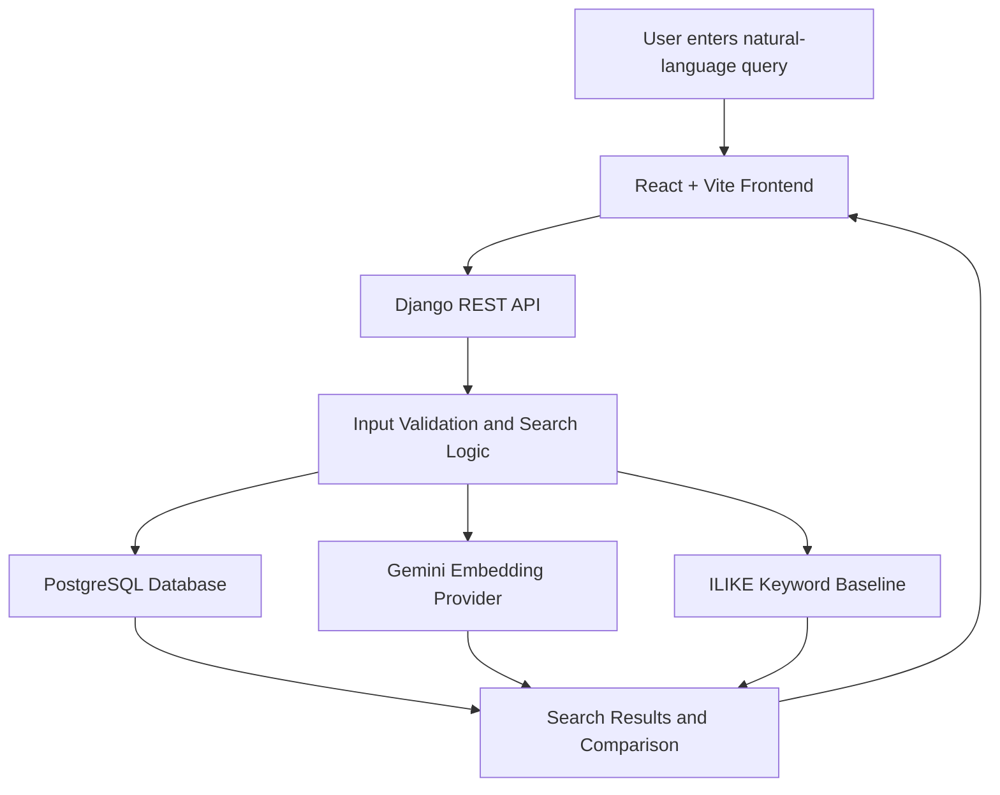

# JevQL — Natural Language Search for PostgreSQL

<p align="center">
  <strong>Search your data by meaning, not just keywords.</strong>
</p>

<p align="center">
  A web application that explores natural-language search over PostgreSQL records and compares semantic search with traditional SQL keyword matching.
</p>

<p align="center">
  
  
  
  
</p>

---

## About the Project

JevQL is a natural-language search project developed by **Team The Confluence** for the Code Yudh Hackathon.

Traditional database searches often depend on exact keywords. However, users frequently express the same idea using different words, phrases, or sentence structures.

For example, a search for `dissatisfied` may miss feedback such as:

- "I have contacted support three times and still have no reply."
- "Honestly, I am thinking of switching providers."
- "Two weeks for a refund is not what I expected."

JevQL aims to make database exploration more intuitive by combining a web-based search workflow with PostgreSQL and a configured semantic-search path.

The project also retains PostgreSQL's `ILIKE` keyword search as a baseline for comparing search approaches.

## Problem Statement

**How can users find relevant database records when those records do not contain the exact words they search for?**

Keyword-based searches are straightforward and useful, but they can miss paraphrases and contextually related text.

JevQL explores a more natural way to search existing PostgreSQL data while retaining a traditional keyword-search baseline for comparison.

## Key Features

- **Natural-language search:** Describe the records you want to find using plain English.
- **PostgreSQL integration:** Use PostgreSQL as the application's relational data store.
- **Semantic-search integration:** A configured Gemini embedding provider supports the planned semantic-search workflow.
- **Keyword baseline:** Compare against conventional PostgreSQL `ILIKE` queries.
- **Web interface:** React-based frontend built with Vite.
- **REST API backend:** Django and Django REST Framework coordinate application requests and backend processing.
- **Search comparison:** Designed to help evaluate where semantic search and keyword matching differ.
- **Evaluation-focused development:** Use synthetic datasets and relevance labels to assess results.

> **Development status:** The Django configuration checks and PostgreSQL connectivity have been verified locally. Gemini provider configuration is present, but the complete semantic-search workflow and its relevance must be validated end to end. Features should be considered complete only after their behavior has been tested.

## Technology Stack

| Component | Technology | Purpose |
|---|---|---|
| Frontend | React 19 | User interface and search experience |
| Frontend tooling | Vite | Development server and build tooling |
| Backend | Python and Django | Application logic and request handling |
| API layer | Django REST Framework | REST API development |
| Database | PostgreSQL | Relational data storage and SQL queries |
| Semantic-search integration | Gemini embeddings | Embedding generation for the configured semantic path |
| Keyword baseline | PostgreSQL `ILIKE` | Traditional text matching |
| Version control | Git and GitHub | Source control and collaboration |

## System Architecture



*This diagram represents the intended application workflow. The actual integration and behavior of each search path must be verified against the current implementation.*

## Project Structure

The repository is organized around the following main areas. Individual filenames may vary as development progresses.

```text
JevQL_The_Confluence/
├── backend/
│   └── Django application and API code
├── frontend/
│   └── React and Vite application
├── database/
│   └── Database scripts and related resources
├── tests/
│   └── Automated and manual test resources
├── manage.py
├── requirements.txt
├── .env.example
├── start_jevql.bat
└── README.md
```

## Getting Started

Follow these instructions to run the project locally. The commands assume the repository contains the listed files and that PostgreSQL is installed and running.

### Prerequisites

Install or configure:

- Git
- Python compatible with the project's dependencies
- Node.js and npm
- PostgreSQL
- A Gemini API key if the semantic-search provider requires it

### 1. Clone the Repository

```bash
git clone https://github.com/vortex-001/JevQL_The_Confluence.git
cd JevQL_The_Confluence
```

### 2. Set Up the Python Environment

From the repository root, create and activate a virtual environment.

**Windows CMD:**

```bat
python -m venv .venv
.venv\Scripts\activate
```

Install backend dependencies:

```bat
pip install -r requirements.txt
```

If the project already includes a working virtual environment, activate that environment instead of creating another one.

### 3. Configure Environment Variables

Create a local `.env` file based on `.env.example`, if available.

Example configuration:

```env
DEBUG=True
SECRET_KEY=replace-with-a-local-secret
DATABASE_NAME=your_database_name
DATABASE_USER=your_database_user
DATABASE_PASSWORD=your_database_password
DATABASE_HOST=localhost
DATABASE_PORT=5432
GEMINI_API_KEY=your_gemini_api_key
```

These names are illustrative. **Use the variable names expected by the actual project settings and provider code.**

Replace all example values with your own local configuration. Never commit real passwords, API keys, or your `.env` file to GitHub.

### 4. Prepare PostgreSQL

Create a PostgreSQL database and configure its credentials in your local environment.

Then run the Django system check:

```bash
python manage.py check
```

Apply migrations if required:

```bash
python manage.py migrate
```

If migrations report that there is nothing to apply, that can be normal. If a database connection fails, verify the database name, username, password, host, port, and PostgreSQL service.

### 5. Start the Backend

From the directory containing the appropriate Django `manage.py` file, run:

```bash
python manage.py runserver 127.0.0.1:8000
```

Keep this terminal running.

If your repository uses a separate `backend/manage.py`, run the command from the backend directory with the correct Python environment and project settings.

### 6. Start the Frontend

Open another terminal:

```bash
cd frontend
npm install
npm run dev
```

Open the local URL printed by Vite in your terminal.

Make sure the frontend API configuration points to the correct backend address and that Django's CORS settings allow the local frontend origin when needed.

## Testing and Evaluation

JevQL is designed to be evaluated against a traditional SQL keyword-search baseline.

### Suggested evaluation workflow

1. Prepare a synthetic dataset containing representative feedback records.
2. Manually label records relevant to a set of natural-language queries.
3. Run the semantic-search path.
4. Run the equivalent PostgreSQL `ILIKE` baseline.
5. Compare the returned records against the labels.
6. Measure precision, recall, latency, and other available usage metrics.

### Example keyword query

```sql
SELECT *
FROM reviews
WHERE feedback ILIKE '%dissatisfied%';
```

This query finds rows containing the specified substring. It may miss records that communicate dissatisfaction using different wording.

### Metrics

| Metric | Purpose |
|---|---|
| Precision | Measures how many returned records are relevant |
| Recall | Measures how many relevant records were retrieved |
| Latency | Measures the time required to complete a search |
| Result overlap | Compares records returned by the two approaches |
| Provider usage | Records usage information when the integration exposes it |

No accuracy, speed, or business-impact claims should be made until these metrics have been measured on a documented evaluation dataset.

## Security and Privacy

- Use synthetic data for demonstrations and initial evaluation.
- Keep database credentials and API keys outside source control.
- Validate incoming requests and restrict database operations to the intended application behavior.
- Use parameterized database queries where appropriate.
- Avoid sending real customer data to an external embedding provider without authorization and a privacy review.
- Configure production secrets and debug settings appropriately before deployment.

## Current Limitations

- End-to-end semantic retrieval and ranking require further verification.
- Search quality must be evaluated against manually labeled records.
- Results can vary with the dataset, query, embedding provider, and retrieval implementation.
- Performance metrics should be reported only after controlled tests.
- Local setup and configuration may differ between development machines.

## Future Scope

- Improve semantic-search relevance and fallback behavior.
- Expand support for approved tables and datasets.
- Add query history and saved searches.
- Improve search analytics and error handling.
- Evaluate larger datasets and different query types.
- Add regression tests for semantic and keyword search behavior.
- Strengthen security, access controls, and privacy safeguards.

## Team

**Team Name: The Confluence**

| Member | Responsibility |
|---|---|
| Harsh Garg | Team Leader, Integration and Testing |
| Tushar | Frontend Development |
| Nitish | Backend Development |
| Saloni | Database and Supporting Development |

## Hackathon

**Event:** Code Yudh — Battle of Codes  
**Submission:** Phase 1  
**Institution:** Chandigarh University

## Repository

[View JevQL on GitHub](https://github.com/vortex-001/JevQL_The_Confluence)

---


<p align="center">
  <strong>JevQL — Search Your Data by Meaning, Not Just Keywords.</strong>
  <br />
  Built by Team The Confluence.
</p>
